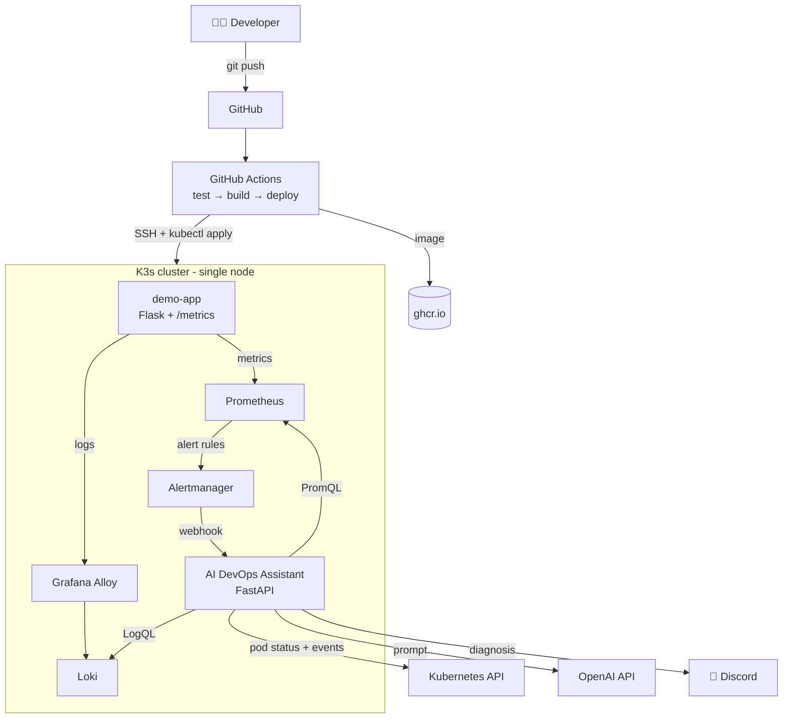

# 🤖 AI-Powered DevOps Assistant

An AI assistant that **diagnoses Kubernetes incidents automatically**. When an alert fires, it gathers context from Kubernetes, Prometheus and Loki, asks an LLM for a root-cause analysis, and posts the diagnosis to Discord, usually within 10 seconds.

The whole platform runs on a single **€5.39/month** server, with an LLM cost of **under half a cent per diagnosis**.


---

## Architecture



## How a diagnosis works

1. **Prometheus** evaluates alert rules (error rate, latency, restarts, plus the built-in Kubernetes rules).
2. **Alertmanager** groups the firing alerts and sends them to the assistant's webhook.
3. The **assistant** gathers context in parallel:
   - **Kubernetes:** pod phase, restart count, last termination reason (e.g. `OOMKilled`), resource limits, recent events
   - **Prometheus:** the alert's own expression, plus memory (current and 15-minute peak), CPU, restarts, request rate by status code, and p95 latency
   - **Loki:** the last 40 error and warning log lines from the namespace
4. The **LLM** returns a structured answer: summary, likely root cause, evidence, suggested fix, and confidence.
5. The diagnosis is posted to **Discord** and also logged, so it's searchable in Loki.

## Example: a real diagnosis

The demo app's `/leak` endpoint was called until the container hit its memory limit. A minute later, the assistant posted:

> 🚨 **DemoAppRestarting** (critical) in `demo`
>
> **Summary:** Pod demo-app is repeatedly restarting and one prior container terminated with OOMKilled (exit 137); logs show an unbounded cache growth.
>
> **Likely root cause:** The application's in-process cache is growing until the container exceeds its memory limit and is OOMKilled.
>
> **Evidence:**
> - `last_terminated=OOMKilled exit_code=137`
> - Logs: `WARNING demo-app cache grew without eviction: 80 MB held in memory`
> - Resource limits: `memory: 128Mi`
>
> **Suggested fix:** Temporarily raise the limit (`kubectl -n demo set resources deployment/demo-app --limits=memory=256Mi`); long term, add cache eviction or a maximum cache size.

<!-- Add a screenshot of a Discord diagnosis: save it as docs/diagnosis.png and uncomment the next line -->
<!--  -->

## Tech stack

| Layer | Technology |
|---|---|
| Infrastructure | OVH VPS (2 vCPU, 4 GB RAM), Ubuntu 24.04, UFW, key-only SSH |
| Orchestration | K3s (lightweight Kubernetes) with Traefik ingress |
| CI/CD | GitHub Actions, GitHub Container Registry |
| Metrics and alerting | Prometheus, Alertmanager (kube-prometheus-stack) |
| Logs | Loki (single binary), Grafana Alloy |
| Dashboards | Grafana, run locally and connected through an SSH tunnel |
| AI assistant | Python, FastAPI, httpx, any OpenAI-compatible LLM API |
| Notifications | Discord webhook |

## Repository structure

```
.
├── demo-app/                  # App we deliberately break
│   ├── app/main.py            # Flask app with Prometheus metrics and failure endpoints
│   ├── tests/
│   ├── k8s/app.yaml           # Deployment, Service, Ingress, ServiceMonitor, alert rules
│   └── Dockerfile
├── assistant/                 # The AI DevOps Assistant
│   ├── app/main.py            # Webhook, context gathering, LLM call, notification
│   ├── tests/
│   ├── k8s/app.yaml           # Deployment, Service, read-only RBAC
│   └── Dockerfile
├── infra/monitoring/          # Helm values for Prometheus, Loki and Alloy
└── .github/workflows/         # One CI/CD pipeline per service
```

## Failure scenarios

The demo app has endpoints that simulate real production problems:

| Endpoint | Simulates | Alert |
|---|---|---|
| `/error` | Database timeouts returning HTTP 500 | `DemoAppHighErrorRate` (more than 20% errors for 1 minute) |
| `/slow` | Slow upstream API (2–5 s) | `DemoAppHighLatency` (p95 above 1 s for 2 minutes) |
| `/leak` | Memory leak (20 MB per call) until OOMKilled | `DemoAppRestarting` |
| `/crash` | Corrupted config file, process exits | `DemoAppRestarting` |

```bash
# Example: trigger a memory leak
for i in $(seq 1 8); do curl -s http://SERVER_IP/leak; echo; done
```

## Cost controls

Running an LLM on every alert could get expensive, so the assistant has guardrails:

- Only **firing** alerts are analyzed; `Watchdog` and `InfoInhibitor` are ignored.
- **30-minute cooldown** per alert, so a flapping alert isn't analyzed repeatedly.
- **At most 20 analyses per hour**, configurable with `MAX_ANALYSES_PER_HOUR`.
- Context is capped (40 log lines, 300 characters per line, 12,000 characters per prompt).
- Low reasoning effort for OpenAI reasoning models.

| Item | Monthly cost |
|---|---|
| OVH VPS (2 vCPU, 4 GB) | €5.39 |
| GitHub, Actions, ghcr.io, Discord | €0 |
| OpenAI (`gpt-5-mini`) | Under €0.005 per diagnosis |

## Security

- SSH with keys only, password and root login disabled, firewall allowing only ports 22, 80 and 443
- The Kubernetes API, Prometheus and Loki are **not exposed** to the internet
- API keys and the webhook URL live in a Kubernetes Secret and are never committed
- The assistant has **read-only** RBAC (get and list on pods and events)
- A dedicated SSH deploy key for CI/CD, with server host-key verification
- Containers run as non-root, with privilege escalation disabled
- The LLM prompt treats logs as **untrusted data**, as a defense against prompt injection through log lines
- Request URLs are never logged, because webhook URLs contain secrets

## Lessons learned

- **Grafana 13 overloaded a 4 GB server.** `vmstat` showed 86% system CPU and around 1.9 GB/s of disk reads: classic memory thrashing. Moving Grafana to the developer's laptop freed the server, since only humans need Grafana; the assistant queries Prometheus and Loki directly.
- **Liveness probes can cause restart loops.** Grafana's slow startup on 2 vCPUs exceeded the default probe window, so Kubernetes kept killing it before it finished starting.
- **UFW blocks pod egress by default.** Routed traffic from the pod network needs explicit `ufw route allow` rules.
- **Give the LLM peak values, not just current ones.** Right after an OOM restart, current memory is low. Adding the 15-minute peak gave the model the evidence it needed.

## Setup

<details>
<summary>Full setup guide</summary>

### 1. Server

```bash
# Packages, swap (2 GB), firewall
sudo apt update && sudo apt upgrade -y
sudo fallocate -l 2G /swapfile && sudo chmod 600 /swapfile && sudo mkswap /swapfile && sudo swapon /swapfile
echo '/swapfile none swap sw 0 0' | sudo tee -a /etc/fstab
sudo ufw default deny incoming && sudo ufw default allow outgoing
sudo ufw allow 22/tcp && sudo ufw allow 80/tcp && sudo ufw allow 443/tcp
sudo ufw allow from 10.42.0.0/16 && sudo ufw allow from 10.43.0.0/16
sudo ufw route allow from 10.42.0.0/16 && sudo ufw route allow from 10.43.0.0/16
sudo ufw enable
```

### 2. K3s and monitoring

```bash
curl -sfL https://get.k3s.io | sh -
sudo snap install helm --classic
helm repo add prometheus-community https://prometheus-community.github.io/helm-charts
helm repo add grafana https://grafana.github.io/helm-charts
helm repo update

cd infra/monitoring
kubectl create namespace monitoring
helm install kps prometheus-community/kube-prometheus-stack -n monitoring -f prometheus-values.yaml
helm install loki grafana/loki -n monitoring -f loki-values.yaml
helm install alloy grafana/alloy -n monitoring -f alloy-values.yaml
```

### 3. Assistant secret

```bash
kubectl create namespace assistant
kubectl create secret generic ai-assistant-config -n assistant \
  --from-literal=LLM_BASE_URL='https://api.openai.com/v1' \
  --from-literal=LLM_MODEL='gpt-5-mini' \
  --from-literal=LLM_API_KEY='...' \
  --from-literal=DISCORD_WEBHOOK_URL='...'
```

Any OpenAI-compatible API works (Gemini, Groq, Anthropic and others): change `LLM_BASE_URL` and `LLM_MODEL`.

### 4. CI/CD

Add these repository secrets in **Settings → Secrets and variables → Actions**:

| Secret | Value |
|---|---|
| `DEPLOY_HOST` | Server IP |
| `DEPLOY_SSH_KEY` | Private key of a dedicated deploy key |
| `DEPLOY_KNOWN_HOSTS` | Output of `ssh-keyscan -t ed25519 SERVER_IP` |

Push to `main`. After the first build, make the `demo-app` and `ai-assistant` packages **public** in GitHub Packages so the cluster can pull them.

### 5. Grafana (local)

```bash
# Tunnel to Prometheus and Loki
ssh -t -L 9090:localhost:9090 -L 3100:localhost:3100 ubuntu@SERVER_IP \
  "sudo k3s kubectl port-forward -n monitoring svc/kps-kube-prometheus-stack-prometheus 9090:9090 & \
   sudo k3s kubectl port-forward -n monitoring svc/loki 3100:3100; wait"

# Grafana on your laptop
docker run -d --name grafana -p 3000:3000 grafana/grafana
```

Add the data sources `http://host.docker.internal:9090` (Prometheus) and `http://host.docker.internal:3100` (Loki), then import dashboards **1860** and **15757**.

</details>

## Roadmap

- [ ] Post a "resolved" message when an alert clears
- [ ] Metrics about the assistant itself (analyses, LLM latency, cost)
- [ ] HTTPS with Let's Encrypt
- [ ] Remember past incidents, so similar alerts can reference earlier diagnoses
